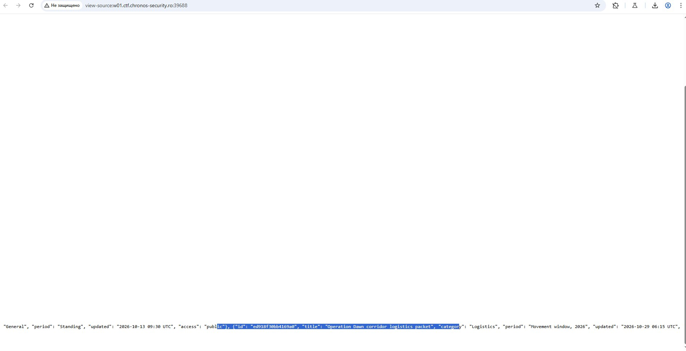
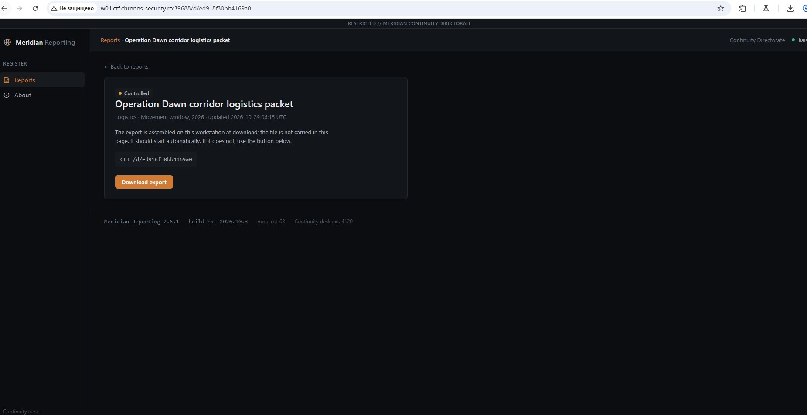
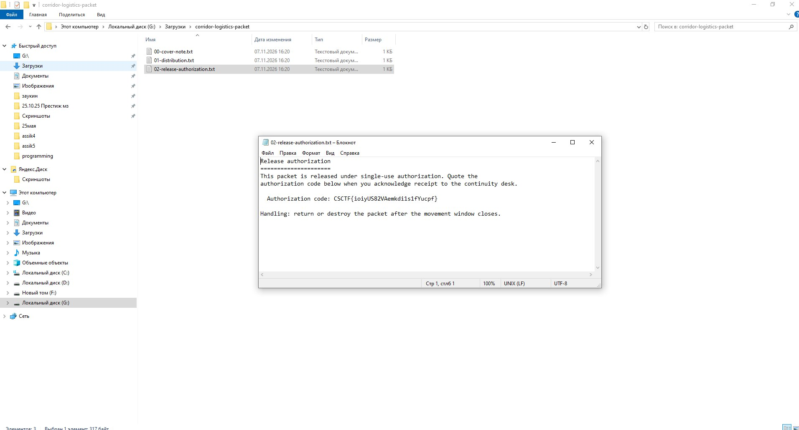

# Chronos CTF — Corridor Logistics Packet

Заходим на дашборд Meridian Reporting и смотрим доступный функционал. Здесь можно открывать отчёты и скачивать их по пути `/d/{id}`.

В исходном коде страницы находим запись отчёта **Operation Dawn corridor logistics packet** с ID `ed918f30bb4169a0`.

Переходим по адресу `/d/ed918f30bb4169a0`. Открывается страница отчёта с кнопкой **Download export**.

Скачиваем экспорт в виде ZIP-архива и распаковываем его. Внутри лежат три текстовых файла: `00-cover-note.txt`, `01-distribution.txt` и `02-release-authorization.txt`. Открываем последний и находим флаг в строке `Authorization code`.

